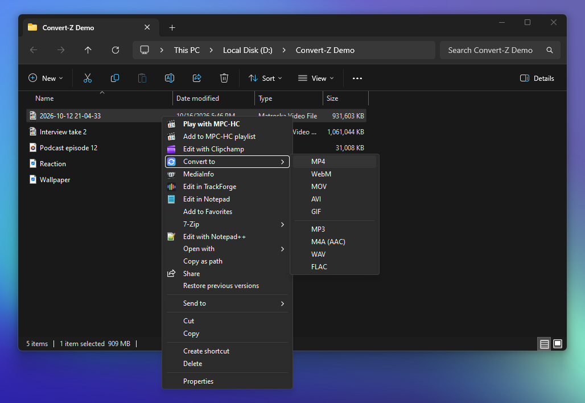
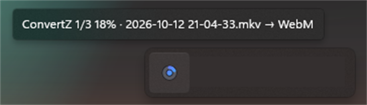
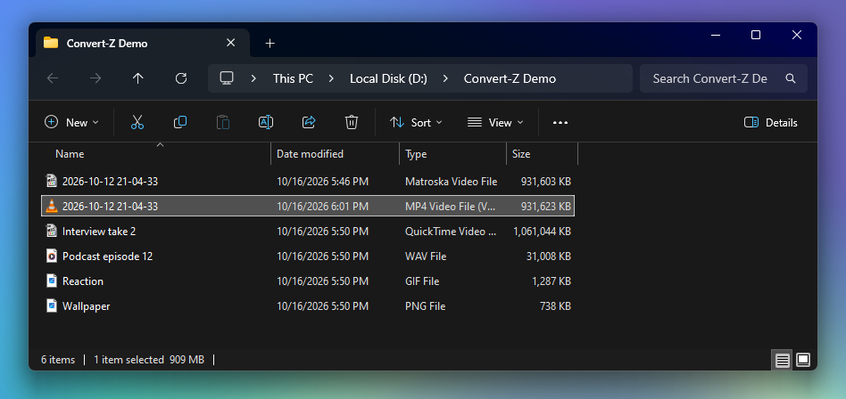

# Convert-Z

Right-click a video, audio or image file, choose **Convert to** and pick a format. The new file shows
up next to the original. A small tray icon shows progress while it works, then disappears.

It uses ffmpeg, and your NVIDIA GPU for video if you have one.







## Install

Grab `ConvertZ.zip` from [Releases](../../releases), unzip it and run `Install.cmd`. No admin needed.
If you don't have ffmpeg, it gets installed with winget.

`Uninstall.cmd` removes it.

On the Windows 11 menu it's under Show more options.

## Formats

| Right-click on | Convert to |
|---|---|
| mp4 mkv mov avi wmv flv webm m4v mpg mpeg ts mts m2ts 3gp ogv vob | MP4, MKV, WebM, MOV, AVI, GIF, or audio only: MP3, M4A, WAV, FLAC |
| gif | MP4, WebM, MOV, MKV, PNG |
| mp3 wav flac m4a m4b aac ogg oga opus wma aif aiff ac3 amr mka wv ape | MP3, M4A, WAV, FLAC, OGG, Opus |
| jpg jpeg jfif png bmp webp tif tiff ico tga avif jxl | PNG, JPG, WebP, BMP, TIFF, ICO |

## Notes

- If the streams already fit the new container it just remuxes, so an OBS mkv becomes an mp4 in a
  second and keeps all its audio tracks.
- MP4, MOV and MKV are encoded as H.264 and WebM as AV1. GPU encoding with ffmpeg 8.1 needs NVIDIA
  driver 610 or newer.
- Existing files are never overwritten; you get `name (1).mp4` instead.
- Select several files and they queue up. Right-click the tray icon to cancel.
- Log: `%LocalAppData%\ConvertZ\ConvertZ.log`

## Building

Needs the .NET SDK and ffmpeg on PATH.

```
.\build.ps1 -SelfTest
```

## License

MIT
